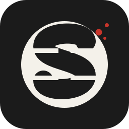

# Schablonen Maker

**Windows-App, die aus einem Foto mehrlagige Banksy-Schablonen macht.**

Foto rein → Detailstufe wählen → fertige Schablonen (SVG/DXF/PDF/PNG) zum Ausschneiden und Sprühen raus.
Alles läuft lokal auf dem Rechner: kein Konto, kein Upload, keine Cloud.



---

## Was die App macht

Aus einem einzigen Foto entstehen 1–6 Schablonen, die übereinander gesprüht das Bild ergeben:

| Schritt | Was passiert |
|---|---|
| **1. Bild** | Foto laden (oder Kamera auf dem Tablet), drehen, Helligkeit/Kontrast, optional Hintergrund freistellen |
| **2. Detail** | Voreinstellung wählen (Silhouette … Maximum) oder Anzahl Ebenen, Feinheit, Glättung und Motivgröße in mm selbst einstellen |
| **3. Schablonen** | Jede Ebene als Schnittmuster ansehen: Materialflächen, Ausschnitte, Inseln, automatische Stege, Sprühreihenfolge, Warnungen |
| **4. Export** | Druck-PDF (maßstabsgetreu, mit Passmarken), SVG, DXF, PNG – einzeln oder alles als ZIP |

Der Stil ist bewusst auf **Banksy** ausgelegt: harter Kontrast, wenige Tonstufen, harte Kanten, Papier als hellster Ton, sichtbare Stege.

---

## Installation (Windows)

**Fertige App:** `npm run dist:win` erzeugt in `release/`

* `SchablonenMaker-1.0.0-x64.exe` – Installer (Startmenü, Desktop-Verknüpfung, kein Admin nötig)
* `SchablonenMaker-1.0.0-portable.exe` – portable Einzeldatei

Voraussetzungen zum Bauen: Windows 10/11, Node.js 20+, einmalig `npm install`.
Die EXE muss auf einem Windows-Rechner gebaut werden (electron-builder kann nicht plattformübergreifend signieren/packen).

### Ohne Installation im Browser

```bash
npm install
npm run dev          # http://localhost:5173
```

Identischer Funktionsumfang (die App erkennt selbst, ob sie in Electron oder im Browser läuft).

### Entwickeln mit Electron

```bash
npm run electron:dev
```

---

## Der Ablauf im Detail

### 1. Bild

* Ziehen und Ablegen, Datei-Dialog oder Kamera (Tablet/Handy im Browser).
* **Helligkeit / Kontrast / Invertieren** – invertieren lohnt bei Negativen oder Motiven auf dunklem Grund.
* **Hintergrund freistellen** (Flutfüllung vom Bildrand): gleichmäßige Hintergründe (Himmel, Studio, glatte Wand) werden zu Papier. Bei unruhigem Hintergrund besser aus lassen – sonst entstehen hellere Säume. Die Toleranz steuert, wie viel als Hintergrund gilt.
* **Rechenqualität**: Schnell 800 px, Standard 1200 px, Hoch 1800 px (längere Bildkante der Arbeitsauflösung). Hoch bringt feinere Konturen für große Wandbilder.

### 2. Detail

**Voreinstellungen**

| Voreinstellung | Ebenen | Charakter |
|---|---|---|
| Silhouette | 1 | Eine Schablone, harter Kontrast, sofort sprühbar |
| Plakat (2) | 2 | Schatten + Schwarz |
| Banksy (3) | 3 | Der Klassiker: drei Tonstufen |
| Fein (4) | 4 | Porträts mit Mittelton-Zeichnung |
| Maximum (6) | 6 | Fast fotografisch, viel Handarbeit |
| Farbe (4) | 4 | Farbcluster im Lab-Raum, z. B. Schwarz + Rot-Akzent |

**Grundwerte**

* **Anzahl Schablonen** 1–6 (in der Farbvariante bis 4).
* **Feinheit** 0–100 steuert drei Mindestmaße gleichzeitig:

  | Feinheit | kleinste Fläche | kleinste Öffnung | schmalster Steg |
  |---|---|---|---|
  | 0 (grob) | 6,5 mm | 4,5 mm | 2,4 mm |
  | 50 | 3,6 mm | 2,5 mm | 1,7 mm |
  | 100 (fein) | 0,6 mm | 0,5 mm | 1,0 mm |

  Grob = schnell geschnitten und gut zu sprühen. Fein = mehr Zeichnung, mehr Geduld.
* **Glättung** 0–100: kantenerhaltender Weichzeichner vor der Tonwertzerlegung. Höher = weniger Sprenkel in Haut, Himmel und Wand.
* **Kontrast**: zieht die Tonwerte auseinander, bevor die Stufen berechnet werden.
* **Motivgröße (Breite in mm)**: bestimmt die Auflösung in Pixeln pro mm und damit, ob mindestens 1 mm breite Stege realistisch sind. Bei 210 mm Breite und 1200 px sind das 5,7 px/mm, ein 1,6-mm-Steg also 9 px.

### 3. Schablonen

Hier zählt jede Ebene als Schnittmuster:

* **schwarz** = Material (stehen lassen),
* **weiß** = Ausschnitt (wird gesprüht),
* **rot/gelb** = erkannte Inseln und die automatisch gesetzten Stege,
* **grün** = Passmarken (Eckenkreuze) zum Übereinanderlegen,
* Zahlen in der Ecke = Sprühreihenfolge.

**Ebenen-Modell**

* **separat**: Jede Ebene enthält nur ihren eigenen Ton. Die hellste wird zuerst gesprüht, die dunkelste zuletzt. Sparsamer im Verbrauch, aber Übergänge können blitzen, wenn man nicht exakt trifft.
* **kumulativ**: Jede Ebene enthält ihren Ton **und alle dunkleren**. Damit sind die Ränder automatisch dicht, man braucht weniger Passgenauigkeit – dafür mehr Farbe und größere Ausschnitte.

**Automatische Stege** – das Herzstück. Material, das vollständig von Ausschnitten umschlossen ist (Pupille, Loch im „O“, Wandfleck), würde beim Ausschneiden herausfallen. Die App sucht für jede Insel den kürzesten Weg zum Rahmen und setzt dort einen Steg. Wege durch Flächen, die eine **spätere, dunklere Ebene ohnehin übermalt**, werden bevorzugt – dort ist der Steg im fertigen Bild unsichtbar.

* **Stegbreite** 0,8–4 mm (mindestens so breit wie der schmalste Steg).
* **Farbübergriff** (nur „separat“): jede Ebene wird minimal größer geschnitten, damit keine Papierfuge zwischen zwei Farben blitzt.
* **Kanten glätten**: Chaikin-Glättung der Konturen (begrenzt auf ~0,4 mm Eckenkürzung, damit Rechtecke keine Achtecke werden).
* **Hellster Ton = Papier**: der hellste Ton wird nicht gesprüht, das Papier scheint durch. Aus = alle Töne werden gesprüht (vollflächiger Druck).
* **Konturen-Ebene**: optionale zusätzliche Schablone mit den Bildkanten (Canny) für eine feine Linienzeichnung obendrauf.

Jede Ebene zeigt Warnungen, wenn etwas nicht schneidbar ist: Inseln ohne Steg, sehr lange Stege (> 8 mm), Flächen über 40 % (zu viel Farbe), fast leere Ebenen, zu wenige Pixel pro mm.

### 4. Export

| Format | Wofür |
|---|---|
| **Druck-PDF** | Maßstabsgetreu in mm, eine Seite je Ebene, Blattaufteilung für große Motive mit Überlappung, Passmarken, Übersichtsseite, Anleitung |
| **SVG je Ebene** | Vektoren in mm für Plotter, Laser, Cricut/Silhouette, Inkscape |
| **SVG als Schnittlinien** | Nur rote Linien, ohne Füllung |
| **DXF je Ebene** | LWPOLYLINE in mm, Y nach oben – LightBurn, RDWorks, LaserGRBL, CNC |
| **PNG je Ebene** | Raster in Druckauflösung für Sprühpausen/Schablonenfolien |
| **ZIP** | Alles zusammen inkl. `anleitung.txt`, `uebersicht.svg`, Projektdatei |

Zusätzlich: **Projekt speichern/öffnen** (JSON mit allen Einstellungen und dem Bild), damit man später weiterarbeiten kann.

---

## Wie es innen funktioniert

```
Foto
 │
 ├─ 1. Vorverarbeitung   Hintergrund-Flut (optional) · Materialrand um das Motiv
 ├─ 2. Helligkeit        sRGB → L* (Tabellen, 3× schneller als pow je Pixel)
 ├─ 3. Glättung          bilateral (bei großen Bildern auf halber Auflösung) → Tonwertkurve
 ├─ 4. Quantisierung     K-Means (1D für Grau, Lab für Farbe) → Tonwertkarte 0…n-1
 │                       Konvention: 0 = hellster Ton … n-1 = dunkelster
 ├─ 5. Aufräumen         Modusfilter (Sprenkel) · kleine Tonflächen der Nachbarstufe zuschlagen
 ├─ 6. Schneidbarkeit    Mindestöffnung: verdicken, was zu schmal zum Schneiden ist
 ├─ 7. Stege             Inselnerkennung · 0-1-BFS zu allen Inseln gleichzeitig
 ├─ 8. Vektoren          Kantenverfolgung auf dem Pixelgitter → Douglas-Peucker → Chaikin
 └─ 9. Ausgabe           Komposit-Simulation, Warnungen, SVG/DXF/PDF/PNG
```

Wichtige Details, die beim Bauen viel Ärger gemacht haben:

* **Tonkonvention**: `level 0` ist immer der hellste Ton. Ohne diese Festlegung sprüht man den Papierrand voll.
* **Ebenen sind kumulativ gedacht**: `Layer.holes = 1` heißt „ausgeschnitten“, also „wird gesprüht“.
* **Distanztransformation** (Felzenszwalb/Huttenlocher) wird für Scheiben-Operationen und den Abstand zur Öffnung genutzt – 12× schneller als Fensterdurchläufe.
* **`thickenThin`** verdickt nur echte Kamm-Pixel, nicht Flächenränder. Sonst wächst jede Fläche in jede Öffnung und das Bild läuft zu.
* **Jede Kante genau einmal**: Die Kantenverfolgung startet nur Kanten, bei denen Material links der Laufrichtung liegt. Startet man in beide Richtungen, liegt jede Kontur doppelt vor und `fill-rule="evenodd"` löscht die Fläche wieder aus – der Export wäre unsichtbar.
* **Glättung mit begrenzter Eckenkürzung**: klassisches Chaikin kürzt Ecken um ein Viertel der Kantenlänge; nach der Vereinfachung wird aus dem rechteckigen Schablonenrand sonst ein Achteck.
* **Kleine Materialinseln** unterhalb der Mindestfläche werden der Sprühfarbe zugeschlagen statt gestegt – sonst ziehen sich Steg-Fäden über den ganzen Hintergrund. Genau das macht auch der Mensch am Schneidetisch.

### Stand der Technik (Recherche)

* Jain et al., *Multi-Layer Stencil* (CAG 2015): Schicht = zusammenhängende Fläche, Inseln über Brücken (Spanning Tree über Kandidaten) verbinden, Reihenfolge so wählen, dass dunkle Schichten frühere Stege überdecken.
* Bronson et al. (2012): Ein-Schicht-Stencils, Insel-Erkennung und Brücken-Strips mit Kostenfunktion – kleinere Inseln zuerst.
* OVERPAINT (ACM 2022): Alternative ohne Brücken durch Übermalen und Flood-Fill-Tonwertkarte; Öffnungsumrisse werden für leichteres Schneiden dilatiert.
* StencilIt und vergleichbare Werkzeuge: 2–8 Töne hell→dunkel, kumulativ/exklusiv, Mindestöffnung/-steg/-fläche, automatische Brücken, Passmarken und Lagen-Nummern, SVG in mm, PDF-Sprühblatt.

Die App setzt davon die praktisch relevanten Teile um: Inseln + Stege (0-1-BFS, bevorzugt durch übermalte Bereiche), Mindestöffnung/-steg/-fläche, kumulativ oder separat, Passmarken, Sprühreihenfolge, maßstabsgetreue Ausgabe.

---

## Entwicklung

```bash
npm install
npm run dev            # Browser-Dev-Server
npm run electron:dev   # Desktop-Fenster
npm test               # 44 Unit-Tests (Vitest)
npm run verify -- samples/portrait.jpg 3 1200   # Pipeline-CLI mit Statistiken
npm run build          # Produktions-Build (dist/)
npm run dist:win       # Windows-Installer + portable EXE (release/)
npm run icons          # App-Icons neu erzeugen
```

### Prüf-Werkzeuge

`scripts/verify.ts` rechnet ein Bild durch die Pipeline, schreibt pro Ebene PNG/SVG/DXF nach `tmp/verify/` und protokolliert Warnungen und Zeiten je Phase. Das ist das wichtigste Werkzeug, um Änderungen an den Algorithmen zu beurteilen – Ausgaben immer **ansehen**, nicht nur Zahlen lesen.

Unter `scripts/dev/` liegen weitere Analyse-Skripte (Variantenvergleich, Hintergrundmasken, Insel-Debug, Benchmark).

### Projektstruktur

```
electron/          main.cjs, preload.cjs (app://-Schema, Menü, Dateidialoge, IPC)
src/core/          Bildverarbeitung ohne UI-Abhängigkeiten
  types.ts         Einstellungen, Voreinstellungen, Qualitätsstufen, Mindestmaße
  color.ts         sRGB→L*, Lab, Hex
  units.ts         mm/Pixel, Papierformate, Blattaufteilung
  morphology.ts    Dilatation/Erosion, Distanztransformation, thickenThin
  filters.ts       bilateral, Tonwertkurve, Canny, Hintergrundmaske
  quantize.ts      K-Means (1D/Lab), Modusfilter
  components.ts    Zusammenhangskomponenten, kleine Tonflächen zusammenfassen
  bridge.ts        Inseln + Stege (0-1-BFS)
  trace.ts         Konturen, Douglas-Peucker, Chaikin
  pipeline.ts      Gesamtablauf
  export/          svg.ts, dxf.ts, print.ts (PDF)
src/worker/        Web-Worker, damit die Oberfläche bedienbar bleibt
src/ui/            React-Oberfläche (Schritte, Zoom, Kamera, Bedienelemente)
tests/             Vitest-Tests
samples/           Beispielbild
```

### Leistung

Bezugsgröße: Porträt, 3 Ebenen, 1200 px Arbeitsbreite, ~1,4 Megapixel, 5,7 px/mm.

| Phase | Zeit |
|---|---|
| Glättung + Tonwerte | ~150 ms |
| Quantisierung + Aufräumen | ~200 ms |
| Mindestöffnung/-steg | ~400 ms |
| Stege je Ebene | ~250–400 ms |
| Vektoren je Ebene | ~30–100 ms |
| Gesamt | **~1,8–2,5 s** |

Die Rechnung läuft im Worker; die Oberfläche bleibt bedienbar und zeigt den Fortschritt. Für schnelles Ausprobieren „Schnell“ (800 px) wählen.

---

## Grenzen

* **Unruhiger Hintergrund** (Laub, Menschenmenge, Mauerwerk) wird als Motiv mitgesprüht. Das ist keine Fehlfunktion, sondern Informationsgehalt: entweder vorher freistellen, die Glättung erhöhen oder ein ruhigeres Foto nehmen.
* **Sehr feine Details** unter der Mindestfläche verschwinden – sonst wäre die Schablone nicht schneidbar.
* **Die EXE muss unter Windows gebaut werden.** Der Quellcode ist plattformunabhängig, das Paketieren nicht.
* **Kein automatisches Freistellen per KI** – die Flutfüllung vom Rand ist absichtlich simpel und vorhersagbar.

## Lizenz

MIT – Nutzung, Veränderung und Weitergabe frei.
